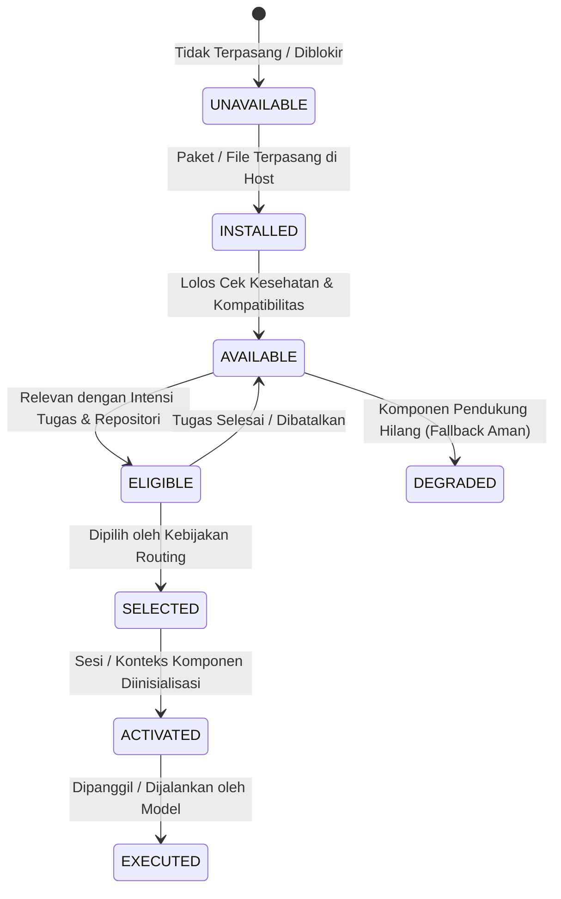

# Afyx Modular Integration & Capability Routing Foundation

**Contract Version:** `AfyxModularIntegration/v1`  
**Governing Principle:** **Standalone by Design, Integrated by Contract, Activated by Need.**  
**Status:** `CANONICAL ARCHITECTURE CONTRACT`  
**Scope:** Afyx Code Engineering Kit across Codex, Antigravity, and Claude Code provider surfaces.  

---

## 1. Prinsip Utama: Standalone by Design, Integrated by Contract, Activated by Need

Fondasi arsitektur Afyx Code Engineering Kit mengadopsi tiga pilar utama:

1. **Standalone by Design (Mandiri sejak Desain):**  
   Setiap produk dan komponen milik Afyx dirancang untuk beroperasi secara penuh dan mandiri tanpa ketergantungan wajib pada komponen Afyx lainnya. Pengguna dapat menginstal satu komponen saja (misalnya *Afyx Efficient Coding* atau *Afyx Graph*) dan memperoleh fungsionalitas penuh komponen tersebut.
2. **Integrated by Contract (Terintegrasi melalui Kontrak):**  
   Ketika beberapa komponen Afyx terpasang dalam satu lingkungan host, komponen-komponen tersebut saling mengenali kapabilitas satu sama lain melalui kontrak terstandar (`AfyxModularIntegration/v1`, `AfyxEngineeringTask/v1`, `AfyxEngineeringResult/v1`, `AfyxToolFamilyRouting/v1`). Tidak ada integrasi ad-hoc, kopling ketat, atau asumsi status tersembunyi.
3. **Activated by Need (Diaktifkan Hanya Berdasarkan Kebutuhan):**  
   Pemasangan komponen **TIDAK PERNAH** berarti aktivasi otomatis. Integrasi tersedia, namun eksekusi bersifat selektif berdasarkan intensi tugas, bukti repositori yang relevan, dan preferensi pengguna. Prinsip ini secara deterministik mencegah duplikasi tanggung jawab, pemuatan konteks redundan, pemanggilan tool tanpa alasan, dan pemborosan konsumsi token.

---

## 2. Inventaris Produk Kanonikal & Identitas Merek

Seluruh komponen milik Afyx memiliki identitas produk kanonikal resmi, sembari mempertahankan identitas stabil (*stable component IDs*) demi kompatibilitas ke belakang:

| Existing Component ID | Canonical Product Name | Tipe Komponen | Tier Default | Kepemilikan | Status Produksi |
|---|---|---|---|---|---|
| `afyx-graph` | **Afyx Graph** | Runtime (Node.js/MCP/CLI) | Optional / Full | AFYX | Siap Produksi (v29) |
| `afyx-context` | **Afyx Context Engine** | Runtime (Node.js/CLI) | Optional | AFYX | Siap Produksi (v0.1.0, Default-OFF) |
| `afyx-engineering-expert` | **Afyx Engineering Expert** | Skill (Prompt / Workflow) | Optional / Recommended | AFYX | Siap Produksi (v0.1.1) |
| `odoo-engineering` | **Afyx Odoo Engineering** | Skill (Prompt / References) | Core / Minimal | AFYX | Siap Produksi (v1.2.0) |
| `efficient-coding` | **Afyx Efficient Coding** | Skill (Prompt / References) | Core / Minimal | AFYX | Siap Produksi (v1.2.1) |
| `codex-usage-tracking` | **Afyx Codex Usage Tracking** | Toolset (PowerShell/VS Code) | Optional (Windows) | AFYX | Siap Produksi |
| `afyx-forge` | **Afyx Forge** | Runtime & Benchmarking | Evaluation | AFYX | **Evaluasi (`UNAVAILABLE_PENDING_A8`)** |

### Aturan Batas Identitas & Kompatibilitas:
- **Stable IDs:** Nilai `id` seperti `efficient-coding`, `odoo-engineering`, `afyx-graph`, dll., tidak berubah dan tetap menjadi jangkar registri, installer, path instalasi, dan provider manifests.
- **Third-Party Attribution:** Dependensi eksternal (seperti `git`, `node`, `python`, `ripgrep`, platform host Codex, Antigravity, Claude Code) mempertahankan identitas, hak cipta, dan lisensi aslinya. Tidak ada rebranding alat pihak ketiga.

---

## 3. Delapan Status Daur Hidup Kapabilitas (*8 Capability Lifecycle States*)

Untuk mencegah kebingungan antara penemuan komponen (*discovery*) dan pemanggilan nyata oleh model (*invocation*), ditetapkan 8 status daur hidup eksplisit:

1. **`INSTALLED`:** File, repositori, atau binary komponen hadir secara fisik pada sistem host.
2. **`AVAILABLE`:** Komponen terpasang, kompatibel dengan OS/platform, dan terverifikasi sehat (*healthy*).
3. **`ELIGIBLE`:** Kapabilitas komponen relevan secara langsung dengan intensi tugas dan bukti repositori saat ini.
4. **`SELECTED`:** Komponen dipilih masuk ke dalam rencana eksekusi oleh penengah routing (*routing arbiter*).
5. **`ACTIVATED`:** Sumber daya, konteks awal, atau MCP transport diinisialisasi untuk sesi tugas.
6. **`EXECUTED`:** Tool, fungsi, atau instruksi komponen dieksekusi secara nyata dalam tugas.
7. **`DEGRADED`:** Komponen beroperasi dengan lingkup terbatas karena komponen opsional lainnya tidak tersedia.
8. **`UNAVAILABLE`:** Komponen tidak terpasang, tidak didukung di platform, dinonaktifkan oleh pengguna, atau ditangguhkan oleh gerbang otorisasi.

---

## 4. Matriks Otoritas Domain & Kepemilikan Kapabilitas Primer

Setiap komponen Afyx memiliki domain otoritas primer yang **tidak boleh saling tumpang tindih (*non-overlapping*)**:

| Komponen Afyx | Kapabilitas Primer | Tanggung Jawab Otoritatif | Komponen Bekerja Sama (*Cooperating*) |
|---|---|---|---|
| **Afyx Forge** | `adaptive-engineering-policy` | Kebijakan eksekusi rekayasa adaptif, alokasi anggaran konteks/tool/validasi | `efficient-coding`, `afyx-engineering-expert`, `afyx-graph`, `afyx-context` |
| **Afyx Efficient Coding** | `focused-coding-discipline` | Disiplin coding terfokus, loop penyelidikan kualitas, panduan implementasi proporsional | `afyx-graph`, `afyx-context` |
| **Afyx Engineering Expert** | `cross-disciplinary-expertise` | Seleksi 13 disiplin keahlian rekayasa sistemik dan perutean alur kerja | `odoo-engineering`, `afyx-graph` |
| **Afyx Odoo Engineering** | `odoo-framework-authority` | Otoritas teknis framework Odoo (ORM, model, XML view, migrasi, versi 10–20) | `afyx-graph`, `afyx-engineering-expert` |
| **Afyx Graph** | `repository-graph-evidence` | Bukti struktural repositori, dependensi lintas aset, dan analisis dampak perubahan | `afyx-context`, `odoo-engineering`, `efficient-coding` |
| **Afyx Context Engine** | `bounded-context-optimization` | Optimasi konteks terikat, pemulihan tepat (*exact recovery*), dan fallback | `afyx-graph`, `efficient-coding` |
| **Afyx Codex Usage Tracking** | `codex-usage-telemetry` | Pemantauan pasif telemetri dan perkiraan biaya penggunaan token Codex | *(Mandiri)* |

---

## 5. Spesifikasi Perilaku Perutean & Pencegahan Redundansi

### 5.1. Kasus 1: Perbaikan Bug Sederhana (*Simple Code Fix*)
- **Intensi:** Koreksi sintaks, perbaikan bug terlokalisasi, refaktor fungsi kecil.
- **Kepemilikan Primer:** `efficient-coding` (Loop GROUND → LOCATE → REPRODUCE → CHANGE → VALIDATE).
- **Pencegahan Redundansi:**
  - `afyx-engineering-expert` **DINONAKTIFKAN** (Status: `AVAILABLE`, Alasan: Mencegah overhead orkestrasi persona ganda dan konsumsi token sia-sia).
  - `afyx-graph` **TIDAK DIPANGGIL** jika target dan simbol sudah diketahui pasti (cukup `DIRECT_SOURCE` / ripgrep).
  - `afyx-context` **TIDAK DIAKTIFKAN** (tetap Default-OFF).

### 5.2. Kasus 2: Isu Keamanan atau Fitur Odoo (*Odoo Task*)
- **Intensi:** Pembuatan model, perbaikan hak akses record rule, migrasi versi Odoo.
- **Kepemilikan Primer:** `odoo-engineering` (Memegang otoritas penuh terhadap sintaks ORM dan versi Odoo 10–20).
- **Kerja Sama Terikat:**
  - `afyx-graph`: Bekerja sama jika tugas memerlukan pencarian relasi lintas modul (*cross-asset resolution*).
  - Jika `afyx-graph` tidak terpasang/unhealthy: sistem melakukan degradasi aman ke pencarian teks `DIRECT_SOURCE`, dan `odoo-engineering` tetap berfungsi normal.
- **Repositori Non-Odoo:** Jika repositori terdeteksi bukan proyek Odoo, `odoo-engineering` secara deterministik berstatus `UNAVAILABLE` untuk menghindari pencemaran konteks prompt.

### 5.3. Kasus 3: Desain Arsitektur & Rekayasa Ambigu (*Architecture Task*)
- **Intensi:** Analisis sistemik menyeluruh, perancangan arsitektur, trade-off keandalan data.
- **Kepemilikan Primer:** `afyx-engineering-expert` (Memilih maksimal 1 disiplin primer dan 2 pendukung).
- **Status Afyx Forge:** `afyx-forge` tetap `UNAVAILABLE` (terkunci hingga gerbang A8 disetujui).

### 5.4. Kasus 4: Beban Kerja Konteks Besar (*Large Context Workload*)
- **Kebijakan Default-OFF:** `afyx-context` **hanya** dipilih dan diaktifkan jika terdapat permintaan opt-in eksplisit dari pengguna (`optInContextEngine: true`). Jika tidak ada opt-in, Context Engine tidak berjalan di latar belakang.

---

## 6. Kontrak Kemandirian Afyx Forge (*Afyx Forge Independence Contract*)

1. **Metodologi Evaluasi Terpisah:**  
   Metodologi evaluasi Forge (kandidat B0 hingga B5) merupakan instrumen pengukuran performa rekayasa, **bukan dependensi wajib** dari Afyx Code Engineering Kit.
   - B1 = Baseline *Efficient Coding*.
   - B2 = Baseline Rekayasa Mandiri (*Afyx-owned Independent Engineering Baseline*).
   - B3 = Komposisi terurut B1 + B2.
   - B4 = Kandidat konvergensi terfein.
   - B5 = Kandidat derivatif asli Afyx.
2. **Kemandirian Komponen:**  
   *Afyx Efficient Coding* dan seluruh produk Afyx lainnya dapat diinstal, digunakan, dan diperbarui sepenuhnya tanpa ketergantungan pada Forge.
3. **Gerbang Produksi:**  
   Tidak ada komponen runtime atau skill produksi bernama *Afyx Forge* yang didaftarkan atau diaktifkan sebelum keputusan formal **Gate A8** disahkan oleh pemilik.

---

## 7. Penegakan 10 Prinsip Integrasi Modular

| No | Prinsip | Penegakan Teknis dalam Kit |
|---|---|---|
| **P1** | *Standalone Operation* | Tiap komponen lolos uji kesehatan tanpa kehadiran komponen lain. |
| **P2** | *Mutual Discovery* | Registri `components.json` dan helper menyediakan penemuan terpadu. |
| **P3** | *No Auto-Activation* | Pemasangan paket tidak memicu eksekusi atau background process otomatis. |
| **P4** | *Need-Based Selection* | Resolver mengevaluasi intent dan bukti sebelum memilih komponen. |
| **P5** | *Domain Ownership* | Menolak aktivasi ganda untuk tanggung jawab yang sama. |
| **P6** | *Safe Degradation* | Komponen absen menghasilkan fallback `DIRECT_SOURCE`, bukan crash. |
| **P7** | *Cost Justification* | Context Engine, Graph index, dan persona expert membutuhkan justifikasi nyata. |
| **P8** | *User Override Priority* | Instruksi eksplisit dan konfigurasi pengguna mengesampingkan optimasi otomatis. |
| **P9** | *Explicit Reporting* | Bukti hilang atau ketidakmampuan dilaporkan secara transparan. |
| **P10**| *Safety Over Efficiency* | Batas izin, keamanan, dan kebenaran selalu mengalahkan token efficiency. |
