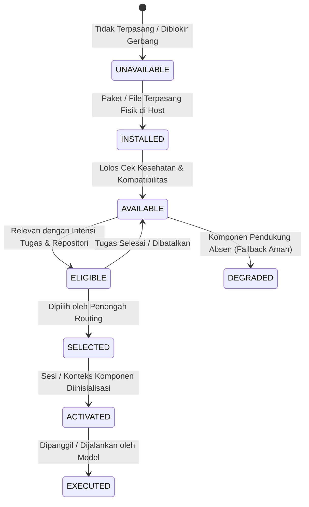

# Afyx Modular Integration & Capability Routing Foundation

**Contract Version:** `AfyxModularIntegration/v1`  
**Governing Principle:** **Standalone by Design, Integrated by Contract, Activated by Need.**  
**Status:** `CANONICAL ARCHITECTURE CONTRACT`  
**Scope:** Afyx Code Engineering Kit across Codex, Antigravity, and Claude Code provider surfaces.  

---

## 1. Prinsip Utama: Standalone by Design, Integrated by Contract, Activated by Need

Fondasi arsitektur Afyx Code Engineering Kit mengadopsi tiga pilar utama:

1. **Standalone by Design (Mandiri sejak Desain):**  
   Setiap produk dan komponen milik Afyx dirancang untuk beroperasi secara penuh dan mandiri tanpa ketergantungan wajib pada komponen Afyx lainnya. Pengguna dapat menginstal satu komponen saja (misalnya *Afyx Efficient Coding* atau *Afyx Graph*) dan memperoleh fungsionalitas penuh komponen tersebut.
2. **Integrated by Contract (Terintegrasi melalui Kontrak):**  
   Ketika beberapa komponen Afyx terpasang dalam satu lingkungan host, komponen-komponen tersebut saling mengenali kapabilitas satu sama lain melalui kontrak terstandar (`AfyxModularIntegration/v1`, `AfyxEngineeringTask/v1`, `AfyxEngineeringResult/v1`, `AfyxToolFamilyRouting/v1`). Tidak ada integrasi ad-hoc, kopling ketat, atau asumsi status tersembunyi.
3. **Activated by Need (Diaktifkan Hanya Berdasarkan Kebutuhan):**  
   Pemasangan komponen **TIDAK PERNAH** berarti aktivasi otomatis. Integrasi tersedia, namun eksekusi bersifat selektif berdasarkan intensi tugas, bukti repositori yang relevan, dan preferensi pengguna. Prinsip ini secara deterministik mencegah duplikasi tanggung jawab, pemuatan konteks redundan, pemanggilan tool tanpa alasan, dan pemborosan konsumsi token.

### Batas Kematangan Integrasi (*Integration Maturity Boundary*):
- Dokumen dan implementasi ini mendefinisikan **kebijakan perencanaan kapabilitas deterministik** (*deterministic capability planning*).
- Pengkabelan runtime langsung (*live runtime wiring*) ke event loop CLI/IDE provider, middleware hook runtime, atau transport live MCP merupakan **batas penerimaan terpisah** (*separate acceptance boundary*).
- Tidak ada klaim perutean runtime langsung atau klaim penghematan token empiris tanpa bukti pengukuran terverifikasi.

---

## 2. Inventaris Produk Kanonikal & Klasifikasi Kematangan

Seluruh komponen milik Afyx memiliki identitas produk kanonikal resmi, sembari mempertahankan identitas stabil (*stable component IDs*) demi kompatibilitas ke belakang:

| Existing Component ID | Canonical Product Name | Tipe Komponen | Tier Default | Kepemilikan | Kematangan (*Maturity*) | Status Verifikasi Roadmap |
|---|---|---|---|---|---|---|
| `afyx-graph` | **Afyx Graph** | Runtime (Node.js/MCP/CLI) | Optional / Full | AFYX | `SOURCE_READY` | Finalisasi v1 Aktif (Penerimaan Integrasi Diperluas & T12 Pending) |
| `afyx-context` | **Afyx Context Engine** | Runtime (Node.js/CLI) | Optional | AFYX | `SOURCE_READY` | Finalisasi v1 Aktif (Default-OFF, Penerimaan Integrasi Diperluas Pending) |
| `afyx-engineering-expert` | **Afyx Engineering Expert** | Skill (Prompt / Workflow) | Optional / Recommended | AFYX | `SOURCE_READY` | Finalisasi v1 Aktif (D.6 Review & T12 Pending) |
| `odoo-engineering` | **Afyx Odoo Engineering** | Skill (Prompt / References) | Core / Minimal | AFYX | `SOURCE_READY` | Finalisasi v1 Aktif (Penerimaan Routing Terpasang & T12 Pending) |
| `efficient-coding` | **Afyx Efficient Coding** | Skill (Prompt / References) | Core / Minimal | AFYX | `SOURCE_READY` | Finalisasi v1 Aktif (Disiplin Implementasi Inti) |
| `codex-usage-tracking` | **Afyx Codex Usage Tracking** | Toolset (PowerShell/VS Code) | Optional (Windows) | AFYX | `STANDALONE_ACCEPTED` | Diterima Mandiri (Windows Toolset) |
| `afyx-forge` | **Afyx Forge** | Runtime & Benchmarking | Evaluation | AFYX | `SOURCE_READY` | **Evaluasi (`UNAVAILABLE_PENDING_A8`)** |

### Definisi Tingkat Kematangan Produk (*Product Maturity Vocabulary*):
Sesuai kontrak otoritatif pada `docs/AFYX_V1_MASTER_ROADMAP.md`, keempat status berikut memiliki batasan tegas dan tidak dapat saling menggantikan:
1. **`SOURCE_READY`:** Implementasi telah ada pada kode sumber kanonikal dan pengujian terfokus terkait telah lulus.
2. **`STANDALONE_ACCEPTED`:** Eksekusi independen komponen, penanganan kegagalan, pemulihan, kepemilikan, dan kontrak pengemasan lolos pada platform yang didukung.
3. **`INTEGRATION_ACCEPTED`:** Kontrak lintas komponen berversi dan penurunan kemampuan yang anggun (*graceful degradation*) lolos tanpa menjadikan komponen opsional wajib. Penerimaan terpadu dicapai setelah rangkaian integrasi penuh v1 terverifikasi.
4. **`RELEASE_READY`:** Seluruh gerbang v1 yang diperluas, penerimaan produk terpasang, asal-usul artefak (*provenance*), exit Fase 10, dan pemeriksaan Fase 11 lolos. Tidak ada komponen yang dapat mengklaim `RELEASE_READY` hanya dari bukti sumber atau sintetis semata. Tidak ada pernyataan kesiapan produksi prematur (*unsupported production readiness*).

### Aturan Batas Identitas & Kompatibilitas:
- **Stable IDs:** Nilai `id` seperti `efficient-coding`, `odoo-engineering`, `afyx-graph`, dll., tidak berubah dan tetap menjadi jangkar registri, installer, path instalasi, dan provider manifests.
- **Third-Party Attribution:** Dependensi eksternal (seperti `git`, `node`, `python`, `ripgrep`, platform host Codex, Antigravity, Claude Code) mempertahankan identitas, hak cipta, dan lisensi aslinya. Tidak ada rebranding alat pihak ketiga.

---

## 3. Delapan Status Daur Hidup Kapabilitas (*8 Capability Lifecycle States*)

Untuk mencegah kebingungan antara penemuan komponen (*discovery*) dan pemanggilan nyata oleh model (*invocation*), ditetapkan 8 status daur hidup eksplisit:

1. **`INSTALLED`:** File, repositori, atau binary komponen hadir secara fisik pada sistem host.
2. **`AVAILABLE`:** Komponen terpasang, kompatibel dengan OS/platform, dan terverifikasi sehat (*healthy*). Komponen yang terpasang dan sehat tetapi tidak relevan dengan tugas **tetap berstatus AVAILABLE** (tidak boleh diubah menjadi UNAVAILABLE hanya karena tidak relevan).
3. **`ELIGIBLE`:** Kapabilitas komponen relevan secara langsung dengan intensi tugas dan bukti repositori saat ini.
4. **`SELECTED`:** Komponen dipilih masuk ke dalam rencana eksekusi oleh kebijakan perutean.
5. **`ACTIVATED`:** Sumber daya, konteks awal, atau MCP transport diinisialisasi untuk sesi tugas.
6. **`EXECUTED`:** Tool, fungsi, atau instruksi komponen dieksekusi secara nyata dalam tugas.
7. **`DEGRADED`:** Komponen beroperasi dengan lingkup terbatas karena komponen opsional lainnya tidak tersedia.
8. **`UNAVAILABLE`:** Komponen tidak terpasang secara fisik, tidak didukung di platform, dinonaktifkan oleh pengguna, atau ditangguhkan oleh gerbang otorisasi formal (misalnya *Afyx Forge* sebelum A8).

---

## 4. Matriks Otoritas Domain & Kepemilikan Kapabilitas Primer

Setiap komponen Afyx memiliki domain otoritas primer yang **tidak boleh saling tumpang tindih (*non-overlapping*)**:

| Komponen Afyx | Kapabilitas Primer | Tanggung Jawab Otoritatif | Komponen Bekerja Sama (*Cooperating*) |
|---|---|---|---|
| **Afyx Forge** | `adaptive-engineering-policy` | Kebijakan eksekusi rekayasa adaptif, alokasi anggaran konteks/tool/validasi | `efficient-coding`, `afyx-engineering-expert`, `afyx-graph`, `afyx-context` |
| **Afyx Efficient Coding** | `focused-coding-discipline` | Disiplin coding terfokus, loop kualitas (GROUND → LOCATE → REPRODUCE → CHANGE → VALIDATE) | `afyx-graph`, `afyx-context` |
| **Afyx Engineering Expert** | `cross-disciplinary-expertise` | Seleksi 13 disiplin keahlian rekayasa sistemik dan perutean alur kerja | `odoo-engineering`, `afyx-graph` |
| **Afyx Odoo Engineering** | `odoo-framework-authority` | Otoritas teknis framework Odoo (ORM, model, XML view, migrasi, versi 10–20) | `afyx-graph`, `afyx-engineering-expert` |
| **Afyx Graph** | `repository-graph-evidence` | Bukti struktural repositori, dependensi lintas modul, dan analisis dampak | `afyx-context`, `odoo-engineering`, `efficient-coding` |
| **Afyx Context Engine** | `bounded-context-optimization` | Optimasi konteks terikat, pemulihan tepat (*exact recovery*), dan fallback | `afyx-graph`, `efficient-coding` |
| **Afyx Codex Usage Tracking** | `codex-usage-telemetry` | Pemantauan pasif telemetri dan perkiraan biaya penggunaan token Codex | *(Mandiri)* |

---

## 5. Spesifikasi Perilaku Perutean & Penanganan Kasus Batas

### 5.1. Kasus Tugas Non-Coding & Klasifikasi Tugas DevOps
- **Tugas Murni Non-Coding (`documentation`, `document-review`, `general-inquiry`, `conversation`, `prompt-writing`, `plain-question`):**
  - **Intensi:** Penulisan dokumentasi, tanya-jawab umum, percakapan bebas, review dokumen teks tanpa modifikasi kode/otomasi.
  - **Perilaku Selektif:** `efficient-coding` **TIDAK DIPILIH** (Status tetap `AVAILABLE`, Alasan: Tugas non-coding tidak memerlukan disiplin implementasi kode). Redundansi ditekan secara deterministik (`NON_CODING_TASK`).
- **Tugas Konfigurasi DevOps & Otomasi Teknis (`devops-config`, CI/CD workflows, Dockerfiles, Infrastructure-as-Code):**
  - **Klasifikasi Otoritatif:** Tugas DevOps diklasifikasikan sebagai **tugas implementasi rekayasa teknis (*technical implementation task*)**, BUKAN tugas non-coding.
  - **Perilaku Selektif:** `efficient-coding` **DIPILIH (`SELECTED`)** sebagai otoritas disiplin rekayasa kualitas pertama guna memastikan perubahan alur kerja, skrip lingkungan, atau kontainer dilakukan secara proporsional (*scoped change*) dan melewati langkah verifikasi/validasi ketat.

### 5.2. Kasus Perbaikan Bug Sederhana (*Simple Code Fix*)
- **Intensi:** Koreksi sintaks, perbaikan bug terlokalisasi, refaktor fungsi kecil.
- **Kepemilikan Primer:** `efficient-coding` dipilih.
- **Pencegahan Redundansi:**
  - `afyx-engineering-expert` **TIDAK DIPILIH** (Status: `AVAILABLE`, Alasan: Mencegah overhead orkestrasi persona ganda dan konsumsi token sia-sia).
  - `afyx-graph` **TIDAK DIPANGGIL** jika target dan simbol sudah diketahui pasti (cukup `DIRECT_SOURCE` / ripgrep).
  - `afyx-context` **TIDAK DIAKTIFKAN** (tetap Default-OFF).

### 5.3. Kasus Isu Keamanan atau Fitur Odoo (*Odoo Task*)
- **Intensi:** Pembuatan model, perbaikan hak akses record rule, migrasi versi Odoo.
- **Kepemilikan Primer:** `odoo-engineering` dipilih sebagai otoritas framework Odoo.
- **Dukungan Bukti Tugas Eksplisit:** Jika deteksi otomatis repositori Odoo tidak tersedia, tetapi ada bukti tugas eksplisit (`task.taskType` diawali `odoo-` atau intent tugas eksplisit tentang Odoo), `odoo-engineering` **tetap dipilih** berdasarkan bukti tugas yang dibenarkan.
- **Repositori Non-Odoo:** Jika repositori non-Odoo dan tugas bukan tugas Odoo, `odoo-engineering` berstatus `AVAILABLE` namun tidak dipilih (`NOT_ELIGIBLE`), mencegah pencemaran konteks prompt.

### 5.4. Klasifikasi dan Pelaporan Fallback Afyx Graph
Ketika analisis relasional dibutuhkan namun Graph tidak beroperasi normal, sistem mengklasifikasikan kondisi secara presisi tanpa diagnostik kegagalan yang menyesatkan:
1. **`COMPONENT_ABSENT`:** Afyx Graph belum dipasang pada host inang → fallback ke `DIRECT_SOURCE`.
2. **`COMPONENT_UNHEALTHY`:** Afyx Graph terpasang namun database indeks korup atau binary tidak merespons → fallback ke `DIRECT_SOURCE`.
3. **`BYPASSED_BY_USER`:** Pengguna secara eksplisit menetapkan `forceDirectSource: true` → pencarian langsung dijalankan atas permintaan pengguna (bukan kegagalan sistem).
4. **`UNSUPPORTED_CAPABILITY`:** Fitur atau bahasa target berada di luar cakupan parser Graph saat ini → fallback transparan ke `DIRECT_SOURCE`.

### 5.5. Kebijakan Default-OFF Afyx Context Engine
- `afyx-context` **hanya** dipilih dan diaktifkan jika terdapat permintaan opt-in eksplisit dari pengguna (`optInContextEngine: true`). Jika tidak ada opt-in, Context Engine tetap berstatus `AVAILABLE` di host tanpa konsumsi sumber daya.

---

## 6. Kontrak Kemandirian Afyx Forge (*Afyx Forge Independence Contract*)

1. **Metodologi Evaluasi Terpisah:**  
   Metodologi evaluasi Forge (kandidat B0 hingga B5) merupakan instrumen pengukuran performa rekayasa, **bukan dependensi wajib** dari Afyx Code Engineering Kit.
   - B1 = Baseline *Efficient Coding*.
   - B2 = Baseline Rekayasa Mandiri (*Afyx-owned Independent Engineering Baseline*).
   - B3 = Komposisi terurut B1 + B2.
   - B4 = Kandidat konvergensi terfein.
   - B5 = Kandidat derivatif asli Afyx.
2. **Kemandirian Komponen:**  
   *Afyx Efficient Coding* dan seluruh produk Afyx lainnya dapat diinstal, digunakan, dan diperbarui sepenuhnya tanpa ketergantungan pada Forge.
3. **Gerbang Produksi:**  
   Tidak ada komponen runtime atau skill produksi bernama *Afyx Forge* yang didaftarkan atau diaktifkan sebelum keputusan formal **Gate A8** disahkan oleh pemilik. Di dalam metadata registri dan kontrak modular, Forge berstatus **`UNAVAILABLE_PENDING_A8`**.

---

## 7. Penegakan 10 Prinsip Integrasi Modular

| No | Prinsip | Penegakan Teknis dalam Kit |
|---|---|---|
| **P1** | *Standalone Operation* | Tiap komponen lolos uji kesehatan tanpa kehadiran komponen lain. |
| **P2** | *Mutual Discovery* | Registri `components.json` dan helper menyediakan penemuan terpadu. |
| **P3** | *No Auto-Activation* | Pemasangan paket tidak memicu eksekusi atau background process otomatis. |
| **P4** | *Need-Based Selection* | Resolver mengevaluasi intent dan bukti sebelum memilih komponen. |
| **P5** | *Domain Ownership* | Menolak aktivasi ganda untuk tanggung jawab yang sama. |
| **P6** | *Safe Degradation* | Komponen absen menghasilkan fallback `DIRECT_SOURCE`, bukan crash. |
| **P7** | *Cost Justification* | Context Engine, Graph index, dan persona expert membutuhkan justifikasi nyata. |
| **P8** | *User Override Priority* | Instruksi eksplisit dan konfigurasi pengguna mengesampingkan optimasi otomatis. |
| **P9** | *Explicit Reporting* | Bukti hilang atau ketidakmampuan dilaporkan secara transparan. |
| **P10**| *Safety Over Efficiency* | Batas izin, keamanan, dan kebenaran selalu mengalahkan token efficiency. |

---

## 8. Jembatan Integrasi Runtime Modular & Aktivasi Kapabilitas Cerdas (K02)

**Contract Version:** `AfyxModularRuntimeActivation/v1`  
**Modul Implementasi:** `scripts/afyx-modular-runtime.mjs`

### 8.1. Arsitektur 5 Lapisan Integrasi Runtime
1. **Lapisan 1: Deterministic Capability Planning:**  
   Mengevaluasi intent tugas, bukti workspace, dan preferensi pengguna via `resolveModularCapabilityPlan()` tanpa I/O host.
2. **Lapisan 2: Capability Eligibility & Domain Authority:**  
   Menegakkan kepemilikan domain otoritatif tunggal (*single authoritative ownership*) per domain untuk mencegah tumpang tindih (*anti-overlap*).
3. **Lapisan 3: Runtime Readiness & Authorization Checks:**  
   Memeriksa izin host inang, kesiapan indeks tanpa background rebuild otomatis, dan menegakkan larangan bypass CLI jika MCP dinonaktifkan (`CLI_BYPASS_REFUSED`).
4. **Lapisan 4: Provider-Mediated Activation:**  
   Menyesuaikan komponen terpilih dengan batas native provider:
   - **Codex:** Surface MCP (`afyx_graph`), CLI (`afyx-context`), telemetry (`codex-usage-tracking`), dan instruksi/skills.
   - **Antigravity:** Surface MCP (`afyx_graph`), IDE skills directory (`skills/`), dan instruksi. Menolak kapabilitas Codex-spesifik (`UNSUPPORTED_ON_PROVIDER`).
   - **Claude Code:** Surface MCP desktop config (`afyx_graph`), skills, dan instruksi (`CLAUDE.md`).
5. **Lapisan 5: Bounded Runtime Telemetry & Execution Preparation:**  
   Menyusun struktur telemetri terikat dan manifest eksekusi tanpa mengekspos prompt sensitif dan **tanpa klaim penghematan token spekulatif** tanpa penghitung terukur dari provider.

### 8.2. Matriks Pemetaan Surface Provider

| Komponen Terpilih | Codex Surface | Antigravity Surface | Claude Code Surface |
|---|---|---|---|
| `afyx-graph` | MCP (`afyx_graph`) | MCP (`afyx_graph`) | MCP (`afyx_graph`) |
| `afyx-context` | CLI wrapper | Instructions / Skills | Instructions (`CLAUDE.md`) |
| `afyx-engineering-expert` | Instructions / Skills | Skills (`afyx-engineering-expert`) | Skills (`afyx-engineering-expert`) |
| `odoo-engineering` | Instructions / Skills | Skills (`odoo-engineering`) | Skills (`odoo-engineering`) |
| `efficient-coding` | Instructions / Skills | Skills (`efficient-coding`) | Skills (`efficient-coding`) |
| `codex-usage-tracking` | Telemetry / CLI | *Unsupported (Graceful Degradation)* | *Unsupported (Graceful Degradation)* |
| `afyx-forge` | *Blocked (`FORGE_GATED_PENDING_A8`)* | *Blocked (`FORGE_GATED_PENDING_A8`)* | *Blocked (`FORGE_GATED_PENDING_A8`)* |

### 8.3. Penegakan Safeguards Host
- **Penolakan Bypass CLI Diam-diam (`CLI_BYPASS_REFUSED`):**  
  Jika antarmuka MCP dinonaktifkan pada host inang, agen dilarang secara diam-diam memanggil binary CLI atau wrapper eksternal tanpa izin independen eksplisit dari pengguna. Pelanggaran langsung menghasilkan status `BLOCKED`.
- **Penolakan Reindexing Otomatis (`AUTOMATIC_INDEXING_REFUSED`):**  
  Jika database indeks Graph belum siap atau basi (*stale*), sistem mendegradasi eksekusi secara aman ke `DIRECT_SOURCE`, alih-alih meluncurkan proses latar belakang (*daemonic build*) tanpa izin caller.
- **Kunci Produksi Forge (`FORGE_GATED_PENDING_A8`):**  
  Setiap permintaan eksekusi atau aktivasi langsung terhadap *Afyx Forge* sebelum evaluasi formal Gate A8 diblokir secara mutlak (`status: BLOCKED`).

